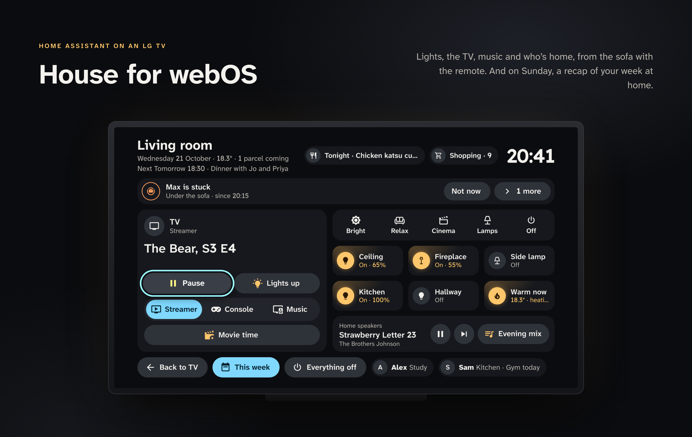
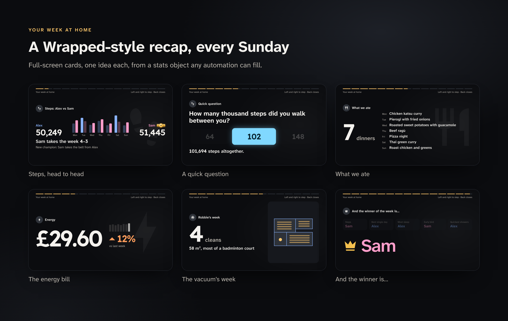
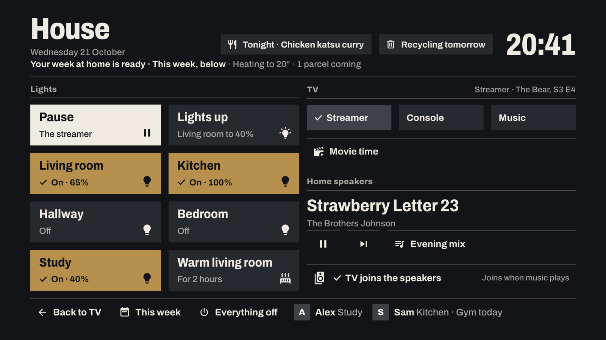

<p align="center">
  
</p>

# House for webOS

A Home Assistant panel for LG TVs, built to be read from the sofa and driven with the remote. It shows the lights,
the TV's sources, what's playing and who's home, and every Sunday it can play a Wrapped-style recap of the week at home.

**[Try the demo in a browser →](https://haydengriffin.github.io/house-webos/)** It runs on made-up data. Use the
arrow keys and Enter; add `&recap` to the URL for the week recap, or `&theme=afterglow` for the Afterglow theme.

## What it does

- **One screen, the room.** Laid out like a Home Assistant wall tablet's room page: the room's line under its name, the
  most urgent notice with its action, the TV as the hero (what's on, sources, quick actions), a row of scenes, the lamps
  with brightness and warmth as tiles, the speakers, and a chip for each person with the room they're in and anything
  else worth knowing ("At work", "Gym today").
- **The shopping list, not just its count.** A chip opens the list on the whole screen, grouped by supermarket aisle;
  OK ticks an item off, with Undo.
- **Made for a remote.** Arrows move by on-screen geometry, so the nearest control in that direction always gets focus.
  OK presses, CH + and CH − brighten and dim the light in focus, Back closes, the Magic Remote pointer works, and it
  closes itself after a minute idle. A door left open, the next calendar event and a status line ("18.3° · 1 parcel
  coming") show at the top.
- **Guest-aware.** Point `guests` at an `input_boolean` and anything marked `private` (sleep, the gym, what someone's
  reading) stays off the screen while it's on.
- **Live.** It holds one websocket to Home Assistant and subscribes to only the entities it shows, using the compressed
  `subscribe_entities` stream, so a 2021 TV keeps up.
- **Your week at home.** Full-screen cards with count-ups, paired bar charts, the gym days, the books you finished or are
  reading (with their covers), a quiz, a guess-the-week reveal and a winner with a drumroll. The cards come from one JSON object that any automation can produce; see
  [`docs/recap-stats.md`](docs/recap-stats.md). An automation can start it on the TV with nobody at the remote.



## Requirements

- An LG TV running webOS. It was built on a 2021 C1 (webOS 6, Chromium 79), so the code is ES5 with no build step.
- The TV in [Developer Mode](https://webostv.developer.lge.com/develop/getting-started/developer-mode-app) and the
  [webOS CLI](https://webostv.developer.lge.com/develop/tools/cli-installation) (`ares-*`) on your computer.
- A Home Assistant user for the TV. Make it non-admin, ideally "local access only", and create a long-lived access
  token for it from its profile page.

> **Status:** House 1.4 runs on a rooted 2021 C1 (a private build of the same code, installed over SSH, since 21 Oct
> 2026). The public package, `ares-install`, the Developer Mode SSH push and launching by `io.github.haydengriffin.house`
> haven't been tried on a TV yet. Reports either way are very welcome.

## Install

The package never contains your config or token, so the same IPK works for every home and is safe to share. The
config goes onto the TV separately, next to the installed app.

1. Build the package and install it on the TV:

   ```bash
   python3 tools/package.py
   ares-setup-device            # once, to add the TV
   ares-install -d <tv> dist/io.github.haydengriffin.house_1.5.0_all.ipk
   ```

2. Copy `config.example.json` to `config.json` and fill in the websocket URL, the token and your entities. Everything
   except `url` and `token` is optional; leave out a section and its panel disappears. `--token-file` keeps the token
   in its own file instead.

3. Put the config on the TV over SSH, then open House:

   ```bash
   python3 tools/push_config.py config.json --ssh root@<tv>                                  # rooted TV
   python3 tools/push_config.py config.json --ssh "-p 9922 -i ~/.ssh/tv_webos prisoner@<tv>"   # Developer Mode
   ```

   It writes `config.js` into the app's folder through SSH's stdin, so the token never appears in a command line.
   Reinstalling the IPK removes it, so push the config again after every install. Whether Developer Mode's SSH user
   may write into the app folder depends on the firmware.

To open House quickly, pin it to the TV's home row or put it on a Quick Access number. Home Assistant can also open it
with the LG webOS integration's `media_player.select_source`, or `webostv.command` with
`system.launcher/launch` and `{"id": "io.github.haydengriffin.house"}`.

Developer Mode sessions run out unless they're extended; the Developer Mode app on the TV shows the time left.

## Configuration

| Key | What it is |
| --- | --- |
| `url`, `token` | `ws://<home assistant>:8123/api/websocket` and the TV user's token. |
| `title`, `locale`, `idle_seconds` | The heading, the date and time format (e.g. `en-GB`), and the auto-close delay. |
| `demo` | `true` runs on the demo states with no Home Assistant, as `?demo` in the URL does. |
| `theme` | Leave it out for the default look. `"afterglow"` sets House in the poster style of the Afterglow TV music app; see [Themes](#themes). |
| `lights` | `[{ name, entity, icon?, on?, off?, action?, step? }]`. A press toggles the entity, or runs `action` instead (e.g. a script that turns the room on at Adaptive Lighting's level). `on` and `off` replace the state text ("On · 60%", "Off"). CH + and CH − on a light in focus step its brightness by `step` percent (default 10); CH − leaves a light that's off alone. |
| `tiles` | `[{ name, sub?, icon?, toast?, entity?, on?, off?, action?, confirm?, visible? }]`. `action` is `{ service: "domain.service", data?, target? }`; with only `entity`, a press toggles it. `sub` shows while the entity is off; `on` and `off` work as on lights. `confirm: true` (or the armed label) makes it a two-press action: the first press arms it red for 5 s. `visible: { entity, states }` shows it only while the entity is in one of those states. |
| `door`, `door_name` | A `binary_sensor`; a chip appears while it's on, with how long for. `door_name` is the chip's text (default "Door open"). |
| `glance` | Header chips: `[{ entity, text?, icon?, attribute?, filter?, hide?, hours?, within_days?, private? }]`. `text` takes `{value}`, `{attr.x}` and `{day}` (the value read as a date: today, tomorrow or the weekday), e.g. `"Tonight · {value}"`. A chip shows only while there's something to say. When the value is a list, `{value}` is how many items it has, or with `filter` how many match every key: a list of values means any of them (a missing key reads as `null`), anything else must be equal. E.g. `"attribute": "items", "filter": { "today": true, "status": ["expected", "out_for_delivery"] }` counts today's parcels still to come; `"hide": ["0"]` hides a count of none. |
| `glance_max` | How many chips fit beside the clock (default 3). Past that, the first ones stay and the rest take turns in the last place, five seconds each. |
| `status` | The room's line under the title, after the date: `[{ entity, text?, ... }]` in the same shape as `glance`, joined with " · ", e.g. `"18.3° · 1 parcel coming"`. Parts with nothing to say drop out. |
| `notices` | `{ entity, room?, dismiss? }`: a notices sensor whose `items` attribute holds `{ id, title, message?, icon?: "mdi:…", level?: "info" \| "warn" \| "alert", action?: { label, service, data? }, rooms?: [...], at? }`. The row shows the most urgent of `room`'s notices (and those for `all`), newest first, with its action as a pill; `dismiss` (an action, called with the notice's `id`) adds Not now, and "N more" steps to the next. |
| `scenes` | `[{ name, icon?, action, entity?, states? }]`: one row of labelled buttons under the TV's side; a scene whose `entity` is in one of `states` (default `["on"]`) is lit. |
| `warmth` | `{ temperature, climate?, action }`: a tile after the lamps that runs `action` (e.g. `{ "name": "Warm now", "icon": "fire", "service": "script.turn_on", … }`), its state the room's temperature and what `climate` is doing ("18.3° · heating"). |
| `lists` | `[{ name, entity: "todo.…", aisles? }]`. A `glance` chip with `"open": "list:0"` opens that list on the whole screen. With `aisles` (a sensor whose `aisles` attribute is `{ aisle id: [item keys] }`), items are grouped by aisle (fruit & veg, bakery, meat & fish, dairy, cupboard, drinks, frozen, household, toiletries), guessing from keywords when the sensor doesn't know an item, and items for another shop ("Makkah: rice") get its own section. OK ticks an item off; it stays with its Undo for six seconds. |
| `guests`, `private` | `guests: { entity, states? }` is in while the entity is in one of `states` (default `["on"]`). Meanwhile anything with `private: true` stays hidden: glance chips, status parts, people's notes, tiles, quick and footer actions, and the recap (`recap.private`). |
| `quick` | Actions on the TV card that take the first focus, e.g. Pause and Lights up while something plays. Same shape as `tiles`. |
| `footer` | Pill buttons after This week, same shape as `tiles`, e.g. Everything off. |
| `calendars` | Calendar entities for the "Next" line. |
| `tv` | `{ title?, source_sensor?, sources: [{ name, icon?, action }], wide? }`. The source whose `name` matches the sensor's state is lit and named under the title; the sensor's `line` attribute, if any, is what's on, big. |
| `music` | `{ title?, player, extra? }`: what's playing, play or pause, next, and `extra`, a pill button with an `action` (e.g. a playlist). |
| `people` | `[{ name, person, room?, notes? }]`. `room` is any sensor whose state is the room name. `notes` are `glance`-shaped lines added after the room, e.g. `{ "entity": "sensor.gym_sam", "attribute": "trained_today", "text": "Gym today", "hide": ["false"], "private": true }`. |
| `recap` | `{ stats, attribute?, cue?, done?, idle_minutes?, ask?, tv?, vacuum_map? }`. `done` is an action called with `reason` when a recap ends that the cue started, or that began while the cue script was running. `tv` is the TV's `media_player`, whose history gives the TV hours when the stats have none. Stats up to six days old that nobody has played on this TV are offered on the home screen ("Your week at home is ready") unless `ask` is false. See [`docs/recap-stats.md`](docs/recap-stats.md). |

Icons are [Material Design Icons](https://pictogrammers.com/library/mdi/) names in camelCase, from the set in
[`app/icons.js`](app/icons.js); add any path you need there.

## Themes



The default look is House's own and needs nothing set. `"theme": "afterglow"` lays one more stylesheet over it,
[`app/themes/afterglow/afterglow.css`](app/themes/afterglow/afterglow.css), so House matches
Afterglow, a poster-style music app for LG TVs, when both run on one TV: an ink ground and warm paper type in one
heavy condensed family (Archivo), 2px hairlines, square corners, no shadows or gradients, and one way to show state
(focus turns a control paper with ink text, the chosen source and anything on carry a drawn tick, disabled is 45%).
Afterglow takes its colour fields from the album art; House has none, so its fields are two neutrals, and its state
colours stay only as flat fields that carry a state: a lit room is a lamp-coloured field, an open door a warn field and
an armed action a red one. The week recap follows it, keeping the two people's colours.

Nothing changes for the default look: `app/theme.js` does nothing without a theme, every rule in the theme's
stylesheet is scoped to `html[data-theme="afterglow"]`, and the stylesheet and its fonts (about 180 KB) are fetched
only when the theme is chosen. An unknown theme name keeps the default. The theme was drawn for the earlier layout: on the room-page layout its lamp tiles are too
tight to show their state, so the default look is the one to use for now.

## Development

Open `app/index.html?demo` in Chrome (`?demo&theme=afterglow` for the Afterglow theme). The layout is fixed at 1920×1080, the TV's resolution; in a smaller window the
demo scales to fit. `app/demo.js` holds the demo home and the full recap stats. The README images are rendered from the
demo by [`tools/showcase`](tools/showcase). To try it against your own Home Assistant, write the config into the
app folder with `python3 tools/push_config.py config.json --out app/config.js` (git ignores it, and the package leaves it
out). Tests: `python3 -m unittest discover -s tests` and `node --test`; lint: `npx --yes eslint@9 app`.

## Support

House for webOS is free and open source. If it made your evenings on the sofa better, you can
[buy me a coffee](https://buymeacoffee.com/haydengriffin). Bug reports and pull requests are just as welcome.

## Licence

[MIT](LICENSE). Bundled icons are Apache 2.0 and the fonts (including Archivo in the Afterglow theme) are SIL OFL 1.1;
see [NOTICE](NOTICE).
